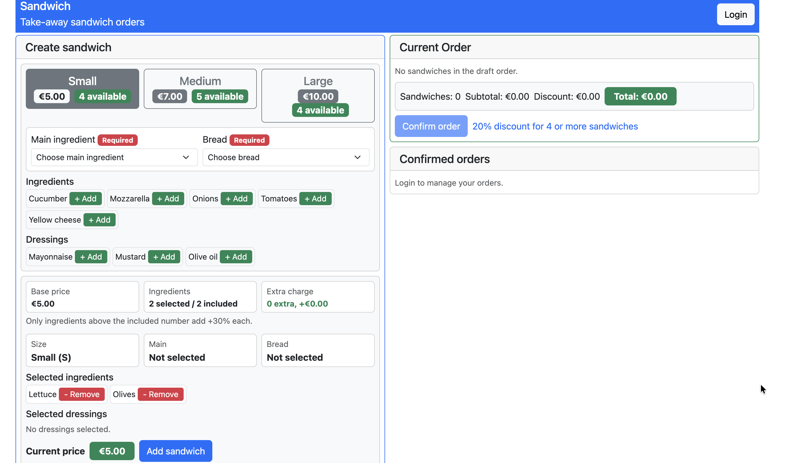
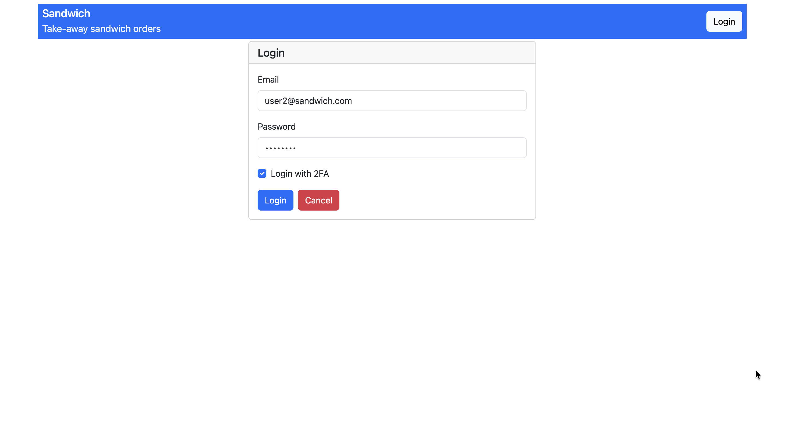
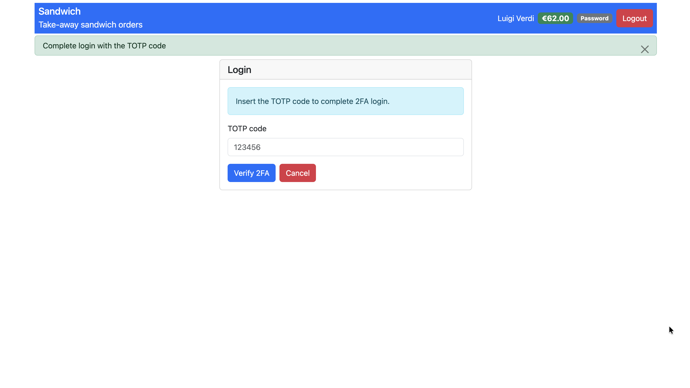
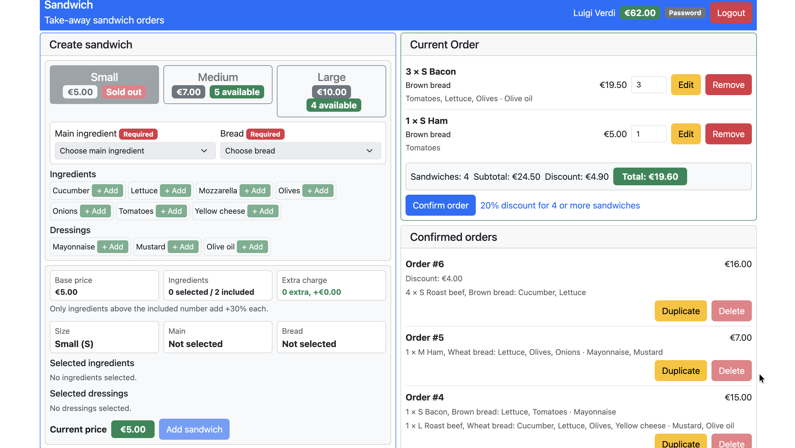
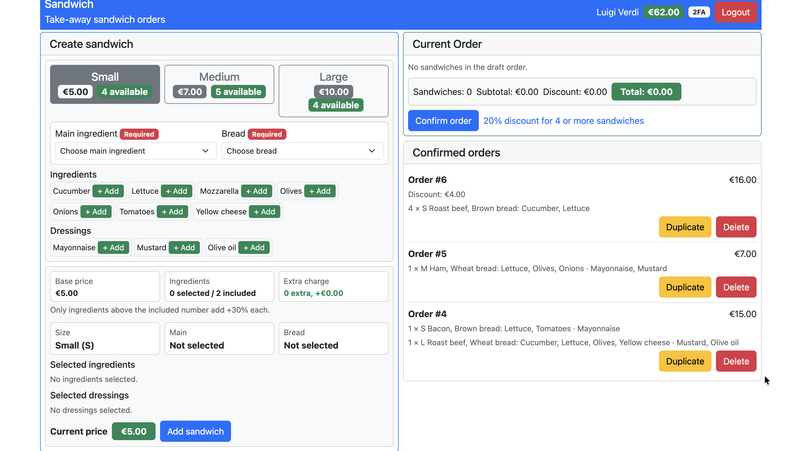
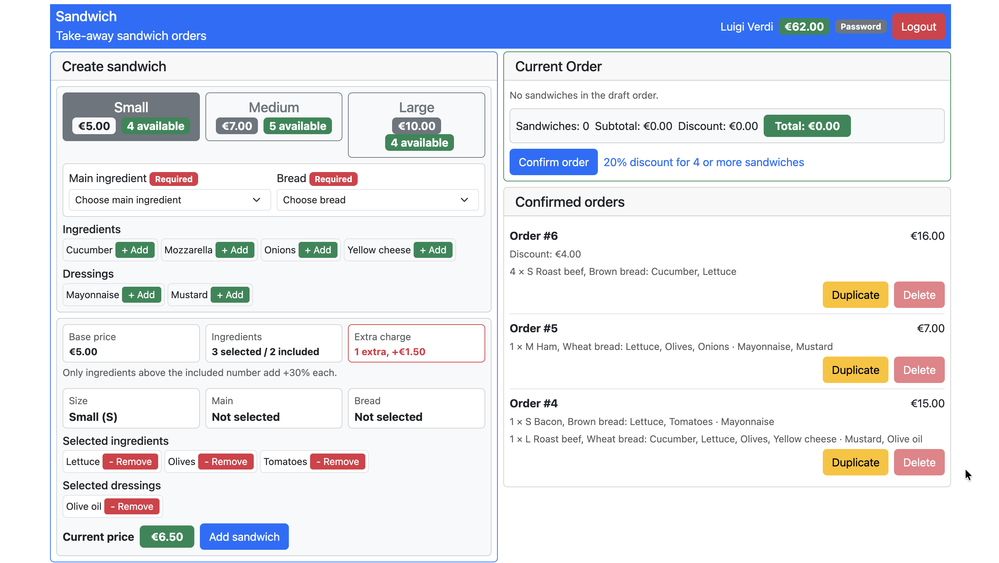

# Exam #2: "Sandwich"
## Student: TAHA ZIED ELGHAZEL

## React Client Application Routes

- Route `/`: public sandwich page. Anyone can see the sandwich sizes availability, main ingredients, bread, optional ingredients and dressings. Logged users can also configure a draft order.
- Route `/ordering`: authenticated ordering page. The user can create sandwiches, manage the current order, confirm it, see confirmed orders, duplicate them, and delete them only if authenticated with TOTP.
- Route `/login`: login form. The user can choose whether to login with password only or with password and TOTP.
- Route `*`: redirects to `/`.

## API Server

- GET `/api/menu`
  - Description: get the public menu with sizes availability, main ingredients, bread, optional ingredients and dressings.
  - Request body: _None_
  - Response body content:
  ```json
  {
    "sizes": [
      { "code": "S", "name": "Small", "price": 5, "included_ingredients": 2, "max_dressings": 1, "daily_limit": 10, "used_quantity": 6, "available": 4 }
    ],
    "mains": [{ "id": 1, "name": "Roast beef", "type": "main" }],
    "breads": [{ "id": 4, "name": "Wheat bread", "type": "bread" }],
    "ingredients": [{ "id": 6, "name": "Lettuce", "type": "ingredient" }],
    "dressings": [{ "id": 13, "name": "Olive oil", "type": "dressing" }]
  }
  ```
  - Error responses: `500` `{ "error": "Database error" }`

- GET `/api/sizes`
  - Description: get the current availability of the three sandwich sizes.
  - Request body: _None_
  - Response body content:
  ```json
  [
    { "code": "S", "name": "Small", "price": 5, "included_ingredients": 2, "max_dressings": 1, "daily_limit": 10, "used_quantity": 6, "available": 4 }
  ]
  ```
  - Error responses: `500` `{ "error": "Database error" }`

- POST `/api/sessions`
  - Description: authenticate the user who is trying to login.
  - Request body content:
  ```json
  { "username": "user1@sandwich.com", "password": "password" }
  ```
  - Response body content:
  ```json
  {
    "email": "user1@sandwich.com",
    "name": "Mario Rossi",
    "credit": 71,
    "canDoTotp": true,
    "is2faVerified": false
  }
  ```
  - Error responses:
    - `422` array of validation error strings (invalid email format, empty password)
    - `401` `{ "error": "Incorrect username and/or password" }`
    - `500` `{ "error": "Database error" }` or `{ "error": "Login error" }`

- POST `/api/login-totp`
  - Description: verify the TOTP code and enable 2FA operations for the current session.
  - Request body content:
  ```json
  { "code": "123456" }
  ```
  - Response body content:
  ```json
  { "otp": "authorized" }
  ```
  - Error responses:
    - `401` `{ "error": "Not authenticated" }` if not logged in
    - `422` array of validation error strings (code is not 6 characters)
    - `400` `{ "error": "Cannot authenticate with TOTP" }` if the user has no TOTP secret configured
    - `401` `{ "error": "Invalid TOTP code" }` if the code is wrong or already used
    - `500` `{ "error": "Database error" }`

- GET `/api/sessions/current`
  - Description: check if the current user is logged in and get his/her data.
  - Request body: _None_
  - Response body content:
  ```json
  {
    "email": "user1@sandwich.com",
    "name": "Mario Rossi",
    "credit": 71,
    "canDoTotp": true,
    "is2faVerified": false
  }
  ```
  - Error responses: `401` `{ "error": "Not authenticated" }`

- DELETE `/api/sessions/current`
  - Description: logout current user.
  - Request body: _None_
  - Response body content: _None_
  - Error responses: `401` `{ "error": "Not authenticated" }`

- GET `/api/orders`
  - Description: get the confirmed orders of the logged-in user.
  - Request body: _None_
  - Response body content:
  ```json
  [
    {
      "id": 1,
      "total_price": 5,
      "discount": 0,
      "sandwiches": [
        {
          "id": 1,
          "size_code": "S",
          "quantity": 1,
          "main_id": 2,
          "main_name": "Ham",
          "bread_id": 4,
          "bread_name": "Wheat bread",
          "ingredients": [{ "id": 6, "name": "Lettuce" }],
          "dressings": [{ "id": 14, "name": "Mustard" }]
        }
      ]
    }
  ]
  ```
  - Error responses:
    - `401` `{ "error": "Not authenticated" }`
    - `500` `{ "error": "Database error" }`

- POST `/api/orders`
  - Description: confirm a draft order. The server checks availability, user credit, ids validity, dressing limits and discount.
  - Request body content:
  ```json
  {
    "sandwiches": [
      {
        "size": "S",
        "mainId": 2,
        "breadId": 4,
        "ingredientIds": [6, 7],
        "dressingIds": [14],
        "quantity": 1
      }
    ]
  }
  ```
  - Response body content:
  ```json
  { "id": 7, "total": 5, "discount": 0, "credit": 66 }
  ```
  - Error responses:
    - `401` `{ "error": "Not authenticated" }`
    - `422` array of validation error strings (invalid size/main/bread/ingredient/dressing/quantity) or `{ "error": "..." }` for business-rule failures (e.g. invalid ids, dressing limit exceeded, not enough availability, insufficient credit)
    - `500` `{ "error": "Database error" }`

- DELETE `/api/orders/:id`
  - Description: delete one confirmed order of the logged-in user. It requires TOTP, restores availability and refunds 90% of the paid amount.
  - Request parameters: order id.
  - Request body: _None_
  - Response body content:
  ```json
  { "refund": 4.5, "credit": 75.5 }
  ```
  - Error responses:
    - `401` `{ "error": "Not authenticated" }` or `{ "error": "Missing TOTP authentication" }`
    - `422` `{ "error": "Invalid order id" }`
    - `404` `{ "error": "..." }` order not found or not owned by the logged-in user
    - `500` `{ "error": "Database error" }`

## Database Tables

- Table `users` - contains _id, email, name, hash, salt, credit, totp_secret, last_totp_step_
- Table `sizes` - contains _code, name, price, included_ingredients, max_dressings, daily_limit, used_quantity_
- Table `items` - contains _id, name, type_
- Table `orders` - contains _id, user_id, total_price, discount_
- Table `sandwiches` - contains _id, order_id, size_code, main_id, bread_id, quantity_
- Table `sandwich_items` - contains _sandwich_id, item_id_

## Main React Components

- `App` (in `App.jsx`): main application component that manages state, routing, API calls, authentication, draft order, prices and messages.
- `AppHeader` (in `AppHeader.jsx`): navigation bar with title, login/logout, user name, credit and authentication method.
- `Feedback` (in `Feedback.jsx`): closable success and error messages.
- `LoginPage` (in `LoginPage.jsx`): login form with optional TOTP verification step.
- `SandwichForm` (in `SandwichForm.jsx`): sandwich configuration form.
- `DraftOrder` (in `DraftOrder.jsx`): current order area with quantity, edit, remove, total and confirm actions.
- `ConfirmedOrders` (in `ConfirmedOrders.jsx`): confirmed orders list with duplicate and delete actions.

## Screenshot
This is the unauthenticated view of the app, where users can see the menu but cannot place orders.


This is the login page where users enter their credentials.


This is the 2FA page where users can enter their TOTP code after logging in.


This is the app main page where user can configure sandwich, add it the current order and confirm order. Also the already confirmed orders of the user.









## Users Credentials

- username: `user1@sandwich.com`, password: `password`, name: Mario Rossi, 3 orders confirmed
- username: `user2@sandwich.com`, password: `password`, name: Luigi Verdi, 3 orders confirmed (different sandwich sizes in one order and multiple units of the same sandwich)
- username: `user3@sandwich.com`, password: `password`, name: Maria Bianchi
- username: `user4@sandwich.com`, password: `password`, name: Francesca Neri 
